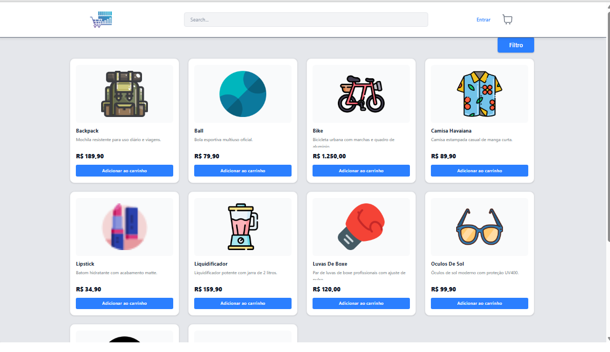

# 🛒 Shopping Market — E-Commerce

Aplicação web de mercado e compras online, com carrinho de compras e login.

**🚀 Ver funcionando:** [\[Clique aqui para acessar a aplicação em produção\]](https://shopping-market-tic.vercel.app/)

### O que o projeto faz

- Listagem de produtos
- Busca de produtos com filtro
- Carrinho de compras (adicionar, remover, alterar quantidade)
- Login e cadastro
- API simulada com JSON Server

> Obs: O back-end é simulado com JSON Server, para treinar o consumo de API no front-end.

### Telas do Projeto

<div align="center">
  
</div>

### Tecnologias que usei

- React.js + Vite
- TypeScript
- Tailwind CSS
- Axios para chamadas HTTP
- TanStack Query para buscar e guardar os dados da API
- JSON Server como API simulada

### Como rodar na sua máquina

Esse projeto tem 2 partes: o front e a API simulada. Precisa rodar os 2.

```bash
**1. Clonar:**
git clone https://github.com/ALI84CC/shoppingMarketTic
cd shoppingMarketTic

**2. Rodar a API simulada:**
npm install
npm run server

**3. Em outro terminal, rodar o front:**
npm run dev
```
### Login para testar

Email: teste@teste.com.br
Senha: 123456

### O que eu aprendi nesse projeto

- Comecei na trilha de React do TIC em Trilhas e depois continuei sozinho, refazendo o projeto em TypeScript
- Aprendi a tipar os dados que vêm da API para evitar erro
- Aprendi a usar TanStack Query para não ficar chamando a API toda hora
- Aprendi a separar as chaves de desenvolvimento e produção com .env
